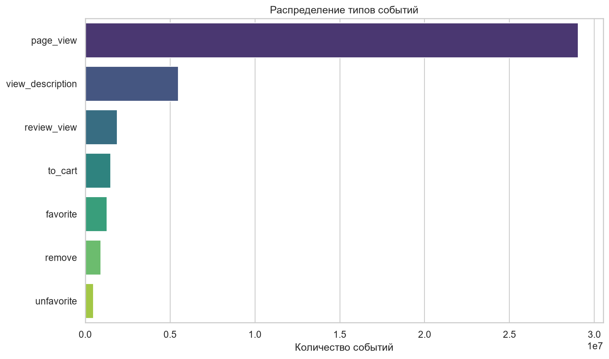
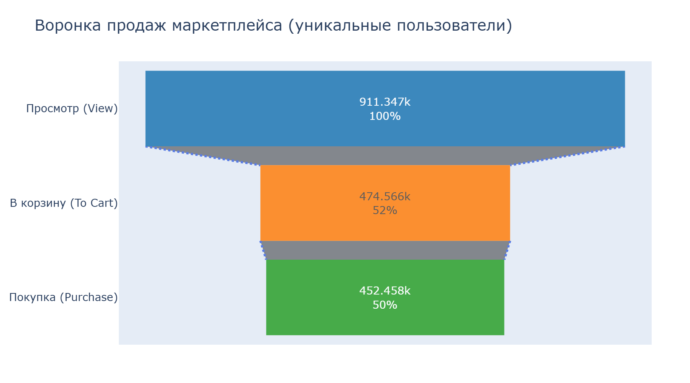
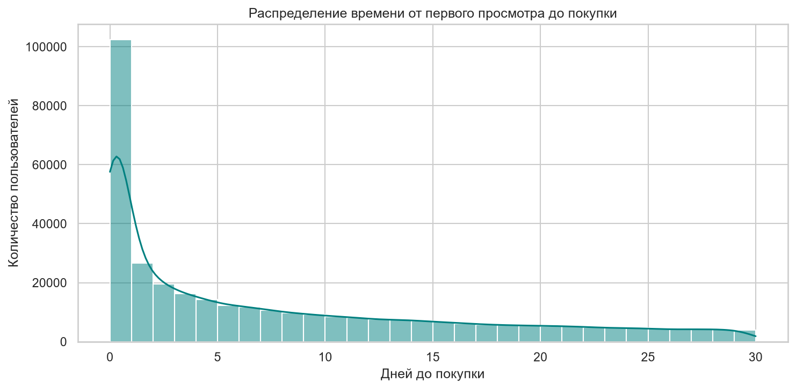
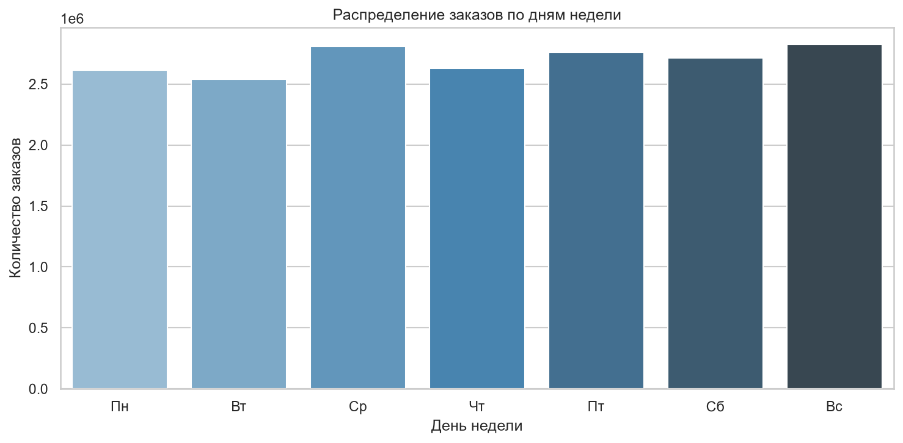
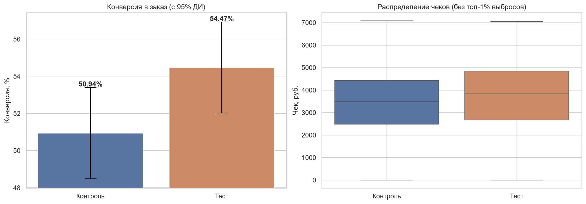
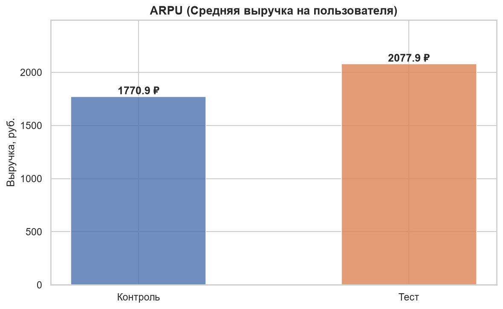
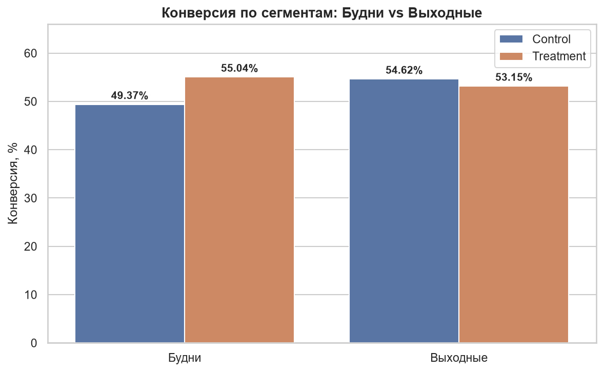

# Анализ воронки продаж и A/B-тестирование (Ozon E-commerce)


## 📋 О проекте

End-to-end исследование продуктовой аналитики на основе открытых логов крупного маркетплейса (Ozon E-CUP 2025). Проект демонстрирует полный цикл работы продуктового аналитика: от разведочного анализа данных (EDA) до построения строгой SQL-воронки и проведения статистического A/B-теста.

**Объём данных:** 40 млн событий (просмотры, корзина) и 18 млн заказов.  
**Стек:** Python (Pandas, SciPy, Statsmodels) · PostgreSQL · Jupyter Notebook.

## 🎯 Бизнес-проблема

Перед продуктовой командой маркетплейса стоят две задачи:
1. **Диагностика:** Декомпозировать путь пользователя и найти узкие места (bottlenecks) в воронке продаж.
2. **Эксперимент:** Проверить, увеличивает ли новый алгоритм рекомендаций (Treatment) конверсию в заказ и средний чек (ARPU) по сравнению со старым (Control).

## 📊 Ключевые результаты

### Воронка продаж (EDA + SQL)
- **Узкое место:** Конверсия из просмотра в корзину — **~52%**. Это главная точка потери клиентов.
- **Скорость:** Медианное время от первого просмотра до оформления заказа — **4.47 дня**.
- **Сезонность:** Пик заказов приходится на воскресенье и среду; минимум — на вторник, четверг также ниже среднего.






### A/B-тест (Статистика)
Эксперимент смоделирован на основе **реальной конверсии из базы** (извлечённой в SQL-ноутбуке).
- **Статистическая значимость:** Различия в конверсии статистически значимы (p-value < 0.05).
- **Бизнес-эффект:** Прирост ARPU (выручки на пользователя) — значимый вклад в выручку.
- **Сегментный анализ:** Эффект неоднороден: в будни Treatment лучше Control, в выходные — наоборот. Требуется дополнительная проверка или сегментированная раскатка.





## 💡 Рекомендации для бизнеса

1. **Раскатка с мониторингом:** Результаты A/B-теста в целом положительные, но сегментный анализ выявил разнонаправленный эффект. Рекомендуется раскатывать новую систему рекомендаций с дополнительным мониторингом по сегментам «будни/выходные» или провести уточняющий тест.
2. **Борьба с оттоком между просмотром и корзиной:** Так как ~48% пользователей теряются на этом переходе, рекомендуется провести A/B-тест нового дизайна карточки товара или упрощения добавления в корзину.
3. **Маркетинговые коммуникации:** Учитывая медианное время до покупки 4.5 дня, необходимо настроить цепочки email/push-уведомлений на первую неделю после первого визита.
4. **Сезонность:** Запуск рекламных кампаний эффективнее планировать с учётом пиков (воскресенье, среда), а не только «на выходные».

## 🧰 Стек технологий

| Слой | Технологии |
|---|---|
| **Хранение** | PostgreSQL, SQLAlchemy, DBeaver |
| **Анализ** | Python (Pandas, NumPy), SQL (CTE, COUNT(DISTINCT), JOIN) |
| **Статистика** | SciPy, Statsmodels (Z-test, T-test, Sample Size) |
| **Визуализация** | Matplotlib, Seaborn, Jupyter Notebook |

## 🛠 Методология

1. **Разведочный анализ (EDA)** — `notebooks/01_funnel_eda_pandas.ipynb`  
   Первичный осмотр данных, распределение типов событий, анализ времени до покупки (Time-to-Convert), активность по дням недели.
2. **Загрузка данных в SQL** — `scripts/load_to_db.py`  
   Загрузка parquet-файлов в PostgreSQL чанками (по 100 000 строк).
3. **SQL-анализ воронки** — `notebooks/02_sql_funnel_analysis.ipynb`  
   Построение строгой (Sequential) воронки через CTE и `COUNT(DISTINCT)`. Расчёт базовой конверсии для A/B-теста. Медианное время до покупки через `PERCENTILE_CONT`. Проверка топ-пользователей на ботов.
4. **A/B-тестирование** — `notebooks/03_ab_test_analysis.ipynb`  
   Расчет размера выборки на основе реальной конверсии из БД, проверка SRM, z-тест для пропорций, t-тест для ARPU, визуализация доверительных интервалов и сегментный анализ.

## 📁 Структура проекта
```
ecommerce-funnel-ab-test/
├── data/
│   ├── raw/                  # Сырые parquet-файлы (не коммитятся)
│   └── processed/            # Очищенные данные (не коммитятся)
├── images/
│   └── funnel/               # Визуализации из ноутбуков
├── notebooks/
│   ├── 01_funnel_eda_pandas.ipynb
│   ├── 02_sql_funnel_analysis.ipynb
│   └── 03_ab_test_analysis.ipynb
├── scripts/
│   └── load_to_db.py
├── .env.example
├── .gitignore
├── README.md
└── requirements.txt
```

## 🚀 Как запустить
1. Клонируйте репозиторий.
2. Установите зависимости: `pip install -r requirements.txt`
3. Скопируйте `.env.example` → `.env` и впишите параметры БД.
4. Создайте БД `ozon_ab_test` в PostgreSQL.
5. Скачайте датасет Ozon E-CUP 2025 и положите parquet-файлы в `data/raw/`.
6. Запустите `python scripts/load_to_db.py` — загрузит данные в PostgreSQL.
7. Выполните `notebooks/01_funnel_eda_pandas.ipynb` — разведочный анализ.
8. Выполните `notebooks/02_sql_funnel_analysis.ipynb` — SQL-воронка.
9. Выполните `notebooks/03_ab_test_analysis.ipynb` — A/B-тест.

## ⚠️ Ограничения анализа
1. **Особенность метрики:** В датасете Ozon E-CUP конверсия нетипично высокая, что связано с фильтрацией трафика. Для A/B-теста используется строгая последовательная воронка (view → cart → purchase), что даёт реалистичную базовую конверсию ~50%.
2. **Данные A/B-теста:** В открытом доступе нет сырых логов реальных экспериментов Ozon, поэтому симуляция проведена на основе реальной базовой конверсии, извлеченной из SQL.
3. **Краткосрочный эффект:** Оцениваются только конверсия и ARPU. Долгосрочные эффекты (Retention, LTV) не анализировались.

## 🗺 Что дальше
- **Retention-анализ:** Оценить влияние алгоритма на повторные покупки через 30/60/90 дней.
- **Многовариантный тест (A/B/C/D):** Сравнить несколько версий алгоритма.
- **Uplift-моделирование:** Выявить сегменты, на которых эффект максимален.

## 👤 Автор
Сухих Елизавета, Junior Data Analyst
- GitHub: [@veta-suhih](https://github.com/veta-suhih)
- LinkedIn: [@vetasuhih](https://www.linkedin.com/in/vetasuhih)
- Telegram: [@veta_suhih](https://t.me/veta_suhih)
- Email: [veta.suhih@gmail.com](mailto:veta.suhih@gmail.com)

## 📄 Лицензия
MIT — используйте код свободно в учебных и коммерческих целях.